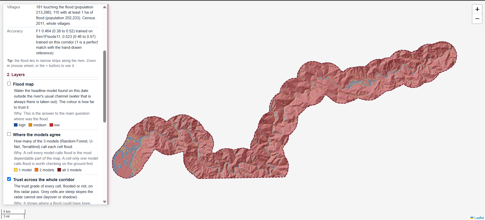
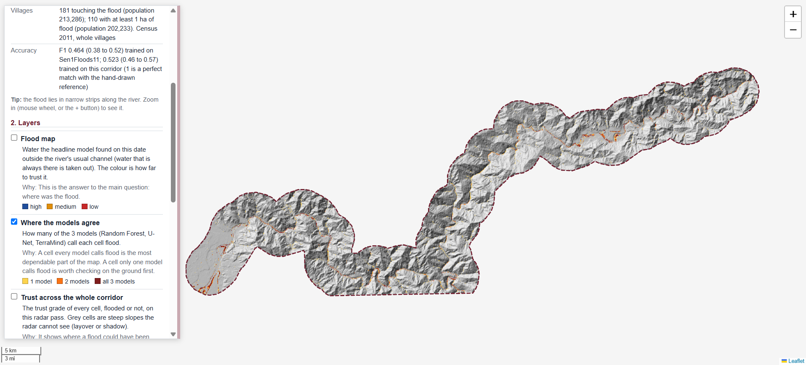
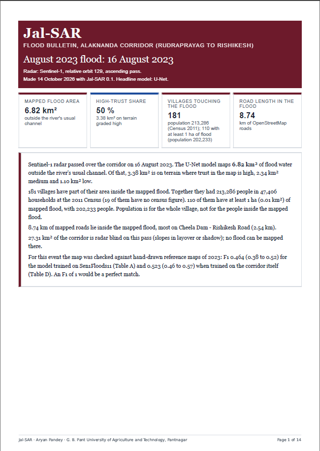
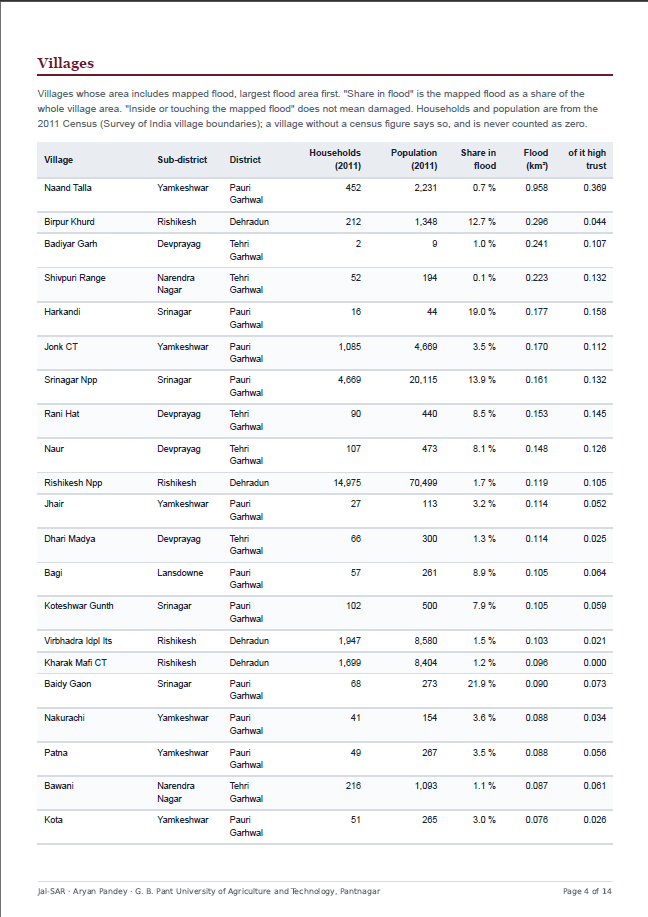
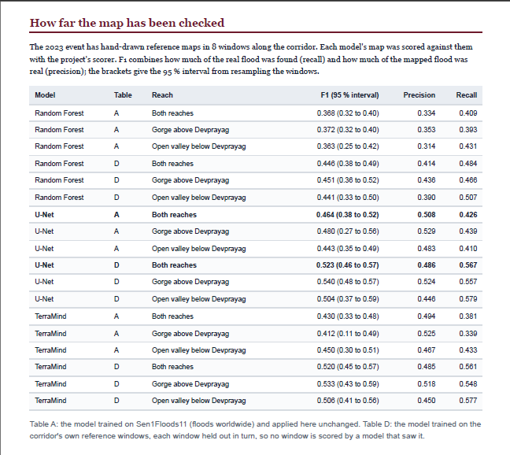

# Jal-SAR

Jal-SAR maps flood water in the Alaknanda corridor (Rudraprayag to Rishikesh, 606 km²) from a Sentinel-1 radar image. It can run for any date with a radar pass, but it has been checked against hand-drawn reference maps for two events only (October 2021 and August 2023). It runs three models, shows where they agree, and marks each part of the map with how far it can be trusted.

## Demo

The first two images are the web map and the last three are the bulletin, both for the August 2023 event.

*Web map, whole corridor, trust layer on.*

*Web map, agreement layer on: how many of the three models call each cell flood.*

*Bulletin, page 1: summary and headline figures.*

*Bulletin, villages with mapped flood, largest flood area first.*

*Bulletin, how far the map has been checked: Table A and Table D, by reach.*

## What it produces

For one date, Jal-SAR writes to `06 Outputs\jalsar\<date>_orbit<nn>\`:

- a flood map from each model (Random Forest, U-Net, TerraMind-small);
- an agreement map, showing how many of the three models call each cell flood;
- a headline map, from the model chosen by the rule below;
- a trust layer, which colours flooded cells by how often that terrain type was right in the test;
- a bulletin, as an HTML page and a PDF: flooded area, villages touching the flood, flooded road length, and the accuracy measured on the corridor;
- a web map, one HTML page that holds every event and layer.

## What it is not

- **Not a warning system.** It maps a flood after a satellite pass. A map can be a day or more behind the peak.
- **Not operational accuracy.** On GRD radar, the best model scores F1 0.41 to 0.52 on the corridor, depending on the year and the test (Table A and Table D). The map is much less reliable on steep slopes and high ground. Where the slope is above 33.46 degrees or the ground is more than 212.76 m above the river (56.7 per cent of the corridor), the inputs are beyond the range the models were trained on. In the checked windows, the headline map scored F1 0.09 to 0.16 on those cells, against 0.44 to 0.48 elsewhere. Every bulletin prints the measured accuracy next to the map.
- **No depth, forecast or damage estimate.** Villages are listed as "inside or touching the mapped flood", not as damaged.
- **Corridor only.** The trust layer was measured on this corridor and nowhere else.

## How the trust layer works

Every corridor cell has three terrain properties: the local radar incidence angle, height above the river (HAND), and valley width. The trust of a cell is the lowest of the three precisions for its classes, taken from the test results. Precision asks: when the map says flood here, how often is it right?

- **High:** precision 0.40 or more.
- **Medium:** 0.20 to 0.40.
- **Low:** under 0.20, or not enough test evidence.
- **Radar blind:** cells in radar layover or shadow. No flood is mapped there, and the map says so.

The classes come from two flood events and 16 test windows on this corridor.

## The headline model

Each model is trained on the hand-labelled Sen1Floods11 set. For TerraMind, the variant with the higher validation IoU is used. The headline model is the one with the highest average F1 on the corridor test (GRD radar, 2021 and 2023). If two models are not clearly different, the faster one is chosen. On the corridor test, TerraMind with terrain and the U-Net are not clearly different: TerraMind's average F1 is higher by 0.001 (0.4894 against 0.4885), and which of the two scores higher changes when they are trained again with a different seed. The U-Net is faster, so it is the headline model. All three models stay in every output.

## Setup

You need Windows 11 and the project's conda environment `fyp`. No new packages are needed.

1. Open `04 Code\jalsar\jalsar_runner.py` in Notepad, find `EE_PROJECT =` (near line 79), and replace the project ID between the quotes with your own Earth Engine project. Keep the quotes.
2. Run `RUN JAL-SAR CHECK DOWNLOAD.bat` once. It downloads the 21 October 2021 scene again and compares it with the copy on disk. It must print `JAL-SAR DOWNLOAD CHECK PASS`.
3. For a new date, run `RUN JAL-SAR.bat` and type the date as `YYYY-MM-DD`.
4. If no radar pass is found, change `SEARCH_DAYS=3` to `SEARCH_DAYS=6` in `jalsar.env`, run again, then change it back.

Build the bulletins and web map from the existing outputs with `RUN JAL-SAR MAPS AGAIN.bat`.

Earth Engine needs a login: run `earthengine authenticate` once in the `fyp` environment.

## Outputs for the three events

| Event | Radar date | Orbit | Reference used | Notes |
|---|---|---|---|---|
| October 2021 | 21 Oct 2021 | 63, descending | yes | validated |
| July 2023 | 19 Jul 2023 | 63, descending | no | radar only, no reference |
| August 2023 | 16 Aug 2023 | 129, ascending | yes | validated; primary event |

## Data and credits

- Radar: Sentinel-1 GRD, through Google Earth Engine. Terrain: Copernicus GLO-30 DEM.
- Water: JRC Global Surface Water; Sentinel-2 dry-season images.
- Training data: Sen1Floods11 (Bonafilia et al., 2020). TerraMind-small (IBM and ESA).
- Roads: © OpenStreetMap contributors (ODbL), downloaded through Overpass.
- Villages and population: Census 2011, from `VILLAGES_corridor.gpkg`. Villages without a census figure are shown as "no census figure", never as zero.
- Rainfall: CHIRPS. Population grid: WorldPop 2020. Land cover: ESA WorldCover 2021; NRSC LULC 50K.

## Licence

MIT. Copyright (c) 2026 Aryan Pandey. The licence covers the code only; the data carry the licences of their sources listed above.
